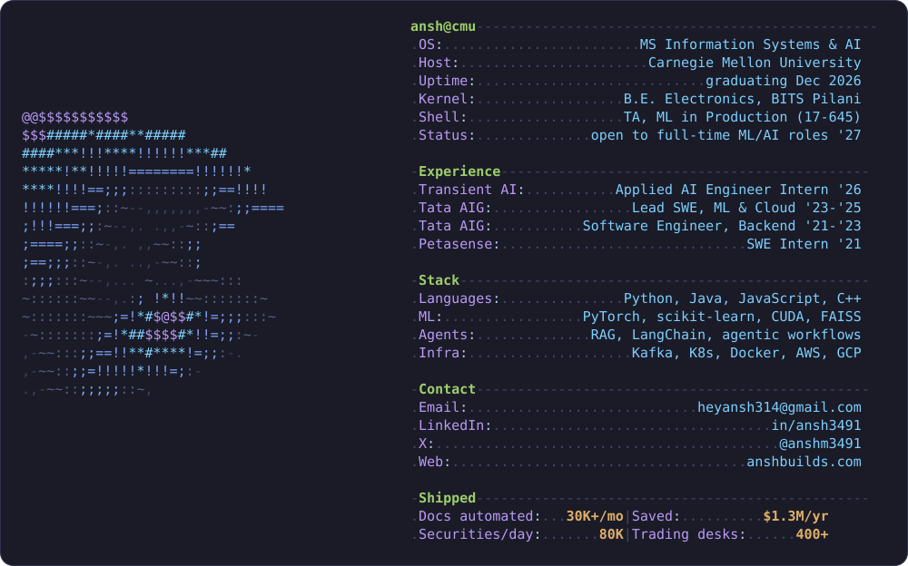
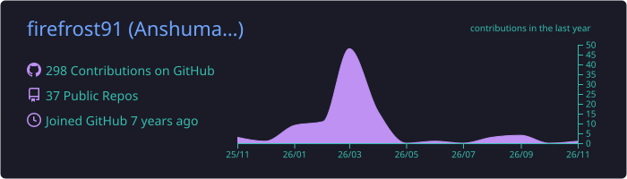
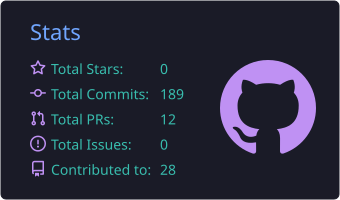
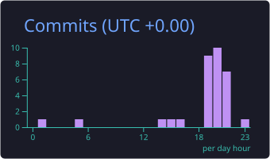
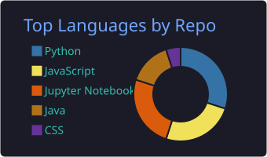
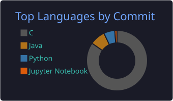

<a href="https://github.com/firefrost91">
  <picture>
    <source media="(prefers-color-scheme: dark)" srcset="assets/card-dark.svg">
    <source media="(prefers-color-scheme: light)" srcset="assets/card-light.svg">
    
  </picture>
</a>

  

  
  
  
  

 

### ⚡ Highlights

- 📈 Built **agents that predict full index rebalances** across LSEG, CRSP, S&P and MSCI, at **~95% accuracy** on CRSP and covering **80K securities a day**
- 🧩 Shipped **DAF**, a no-code platform for agentic workflows used by **400+ trading desks**
- 📄 Built an OCR pipeline that automates **30K+ documents a month**, saving **$1.3M a year**
- 🧑‍🏫 Teaching Assistant for **Machine Learning in Production (17-645)** at CMU SCS
- 🔍 Graduating **Dec 2026** and open to **full-time ML / AI engineering roles**

### 💼 Experience

**Applied AI Engineer Intern** · Transient AI, NYC `Jun – Aug 2026`
> Turned each index provider's methodology into agent-executable logic over LSEG and Snowflake, covering IPO fast-tracks, SPAC/De-SPACs, ADRs and domicile changes. The result was a tradeable pre-trade rebalance view for an index trading desk.

**Lead Software Engineer, ML & Cloud** · Tata AIG, Mumbai `Jul 2023 – Aug 2025`
> Built a document-agnostic OCR pipeline (YOLOv8, PaddleOCR, AWS SQS), a RAG support bot (Mistral 7B on SageMaker) that made query resolution **15% faster**, and a video-based fraud-detection prototype. Led a cross-functional pod and cut code-to-production time by **22%**.

<b>Earlier roles</b>

 

**Software Engineer, Backend** · Tata AIG `Jul 2021 – Jul 2023`
> Built an Insurance Vault on gRPC microservices (Node.js, S3, PostgreSQL) that helped grow app downloads by **12%**.

**Software Engineering Intern** · Petasense, Bangalore `Jan – Jun 2021`
> Built real-time machine-health dashboards in D3 + React that raised anomaly detection by **12%**.

### 🧪 Things I've Built

| Project | Stack | Result |
|:--|:--|:--|
| 🔎 **Neural Search Engine** | Learning-to-rank · Qwen RAG | **NDCG@10 0.44**, beating BM25 on ClueWeb |
| 🎬 **Movie Recommender** | Kafka · ALS · Flask · Grafana | **~1K req/min**, blue-green deploys, auto-retraining |
| 🔐 **Federated Text Prediction** | DP-SGD · gradient compression | 100 clients, **35% less communication** |
| 📱 **Tiny Vision Model** | Distillation · quantization · CoreML | **8× smaller, 3× faster**, >90% accuracy |
| ⚛️ **HIGGS Classifier** | Transformer AE · ResNet + SE | **ROC-AUC 0.80** on 1.1M collision events |

### 🧰 Toolbox

  

Also: CUDA · RAG · agentic workflows · FAISS · LangChain · learning-to-rank · gRPC · DynamoDB · Snowflake

### 📊 GitHub

<picture>
  <source media="(prefers-color-scheme: dark)" srcset="https://raw.githubusercontent.com/firefrost91/profile-readme-draft/output/snake-dark.svg">
  <source media="(prefers-color-scheme: light)" srcset="https://raw.githubusercontent.com/firefrost91/profile-readme-draft/output/snake-light.svg">
  
</picture>

  

  
  

  
  

 

  

