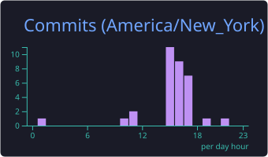

<a href="https://github.com/firefrost91">
  <picture>
    <source media="(prefers-color-scheme: dark)" srcset="assets/card-dark.svg">
    <source media="(prefers-color-scheme: light)" srcset="assets/card-light.svg">
    
  </picture>
</a>

  <b>Applied AI Engineer</b> &nbsp;·&nbsp; ML Systems &nbsp;·&nbsp; Search & Ranking &nbsp;·&nbsp; Distributed Infrastructure

  
  
  
  

 

## Highlights

- Built **agentic pipelines that predict full index rebalances** across LSEG, CRSP, S&P and MSCI, with **~95% accuracy** on CRSP across **80K securities daily**
- Shipped **DAF**, a no-code platform for agentic workflows deployed on **400+ trading desks**
- Built a document-agnostic OCR pipeline that automates **30K+ documents a month**, saving **$1.3M annually**
- Teaching Assistant for **Machine Learning in Production (17-645)**, Carnegie Mellon School of Computer Science
- Graduating **December 2026**; open to **full-time ML / AI engineering roles**

## Experience

**Applied AI Engineer Intern** · Transient AI, New York `Jun 2026 – Aug 2026`
- Encoded each index provider's methodology as agent-executable logic over LSEG and Snowflake, covering IPO fast-track inclusions, SPAC/De-SPACs, ADRs and domicile changes
- Delivered a tradeable pre-trade rebalance view to an index trading desk

**Lead Software Engineer, ML & Cloud** · Tata AIG, Mumbai `Jul 2023 – Aug 2025`
- Built a document-agnostic OCR pipeline (YOLOv8, PaddleOCR, AWS SQS)
- Built a RAG support assistant (Mistral 7B on SageMaker) that cut query resolution time by **15%**, plus a video-based fraud-detection prototype
- Led a cross-functional pod; reduced code-to-production time by **22%**

<b>Earlier roles</b>

 

**Software Engineer, Backend** · Tata AIG, Mumbai `Jul 2021 – Jul 2023`
- Built an Insurance Vault on gRPC microservices (Node.js, S3, PostgreSQL), contributing to a **12%** increase in app downloads

**Software Engineering Intern** · Petasense, Bangalore `Jan 2021 – Jun 2021`
- Built real-time machine-health dashboards (D3, React) that improved anomaly detection by **12%**

## Selected Projects

| Project | Stack | Result |
|:--|:--|:--|
| **Neural Search Engine** | Learning-to-rank, Qwen RAG | **NDCG@10 0.44** over BM25 on ClueWeb |
| **Movie Recommender** | Kafka, ALS, Flask, Grafana | **~1K req/min** with blue-green deploys and automated retraining |
| **Federated Text Prediction** | DP-SGD, gradient compression | 100 clients, **35% lower communication cost** |
| **Efficient Vision Model** | Distillation, quantization, CoreML | **8× smaller, 3× faster**, >90% accuracy |
| **HIGGS Classifier** | Transformer autoencoder, ResNet + SE | **ROC-AUC 0.80** on 1.1M collision events |

## Tech Stack

  

Also: CUDA · RAG · agentic workflows · FAISS · LangChain · learning-to-rank · gRPC · DynamoDB · Snowflake

## GitHub Activity

<picture>
  <source media="(prefers-color-scheme: dark)" srcset="https://raw.githubusercontent.com/firefrost91/profile-readme-draft/output/snake-dark.svg">
  <source media="(prefers-color-scheme: light)" srcset="https://raw.githubusercontent.com/firefrost91/profile-readme-draft/output/snake-light.svg">
  
</picture>

  

  
  

